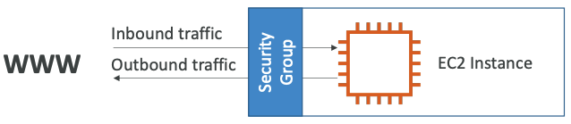
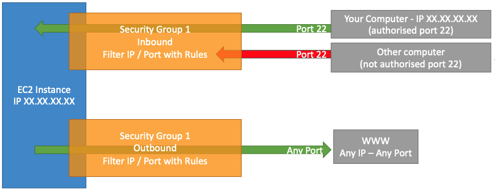

# Security Groups


A Security Group (SG) is a **virtual firewall** for your `EC2 instances`, `RDS databases`, `ECS tasks`, and other `AWS resources` at the **instance level**.

- Security Groups are the fundamental of network security in AWS
- They control how traffic is allowed into or out of our EC2 Instances
- Security groups only contain **allow** rules
- Security groups rules can reference by IP or by security group



## Deep Dive

- Security groups are acting as a *Firewall* on EC2 instances 
- They regulate:
    - Access to Ports 
    - Authorised IP ranges - IPv4 and IPv6 
    - Control of inbound network (from other to the instance) 
    - Control of outbound network (from the instance to other)




### Example 
```
[ Internet ]
     │
     ▼
[ ALB Security Group ]
  Inbound: 80,443 from 0.0.0.0/0
  Outbound: 8080 to App SG
     │
     ▼
[ App Server Security Group ]
  Inbound: 8080 from ALB SG
  Outbound: 3306 to DB SG
     │
     ▼
[ Database Security Group ]
  Inbound: 3306 from App SG
```
### Example 1 — Basic Web Server Security Group

Direction |	Protocol | Port Range |	Source/Destination	| Description
---------- | --------- | ---------- | ---------- | ----------
Inbound | TCP	| 22	 | Your IP (e.g. 203.0.113.10/32) |	SSH access
Inbound	| TCP	| 80	 | 0.0.0.0/0	| Allow HTTP (web traffic)
Inbound	| TCP	| 443    | 0.0.0.0/0	| Allow HTTPS (secure web traffic)
Outbound |	All	| All    | 0.0.0.0/0	| Allow all outbound traffic

### Example 2 — Private App Server (Only From Load Balancer)

Direction |	Protocol | Port Range |	Source/Destination	| Description
---------- | --------- | ---------- | ---------- | ----------
Inbound	   |  TCP	   | 8080      | SG of Load Balancer (`sg-xxxx`) |	Allow only traffic from ALB
Outbound   |	TCP    |	3306   |	SG of Database (`sg-yyyy`) |	Allow DB access
Outbound   |	All    | 	All	   | 0.0.0.0/0	| Allow other outbound (optional)

### Example 3 — Database Security Group

Direction |	Protocol | Port Range |	Source/Destination	| Description
---------- | --------- | ---------- | ---------- | ----------
Inbound	   |  TCP	   | 3306      | App Server SG (`sg-xxxx`) |	Allow DB access from app servers
Outbound   |None    |	—   |	— |	Databases rarely initiate outbound traffic


## Good to know

- Can be attached to multiple instances
- Locked down to a region / VPC combination
- Does live “outside” the EC2 – if traffic is blocked the EC2 instance won’t see it
- *It’s good to maintain one separate security group for SSH access*
- If your application is not accessible (time out), then it’s a security group issue
- If your application gives a “connection refused“ error, then it’s an application error or it’s not launched
- All inbound traffic is **blocked** by default
- All outbound traffic is **authorised** by default


## Classic Ports to know
- 22 = SSH (Secure Shell) - log into a Linux instance
- 21 = FTP (File Transfer Protocol) – upload files into a file share
- 22 = SFTP (Secure File Transfer Protocol) – upload files using SSH
- 80 = HTTP – access unsecured websites
- 443 = HTTPS – access secured websites
- 3389 = RDP (Remote Desktop Protocol) – log into a Windows instance
