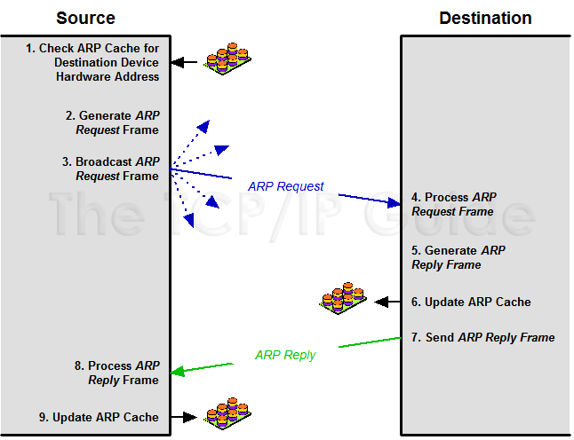

# ARP - Address Resolution Protocol

ARP is used to map an `IP address` to a `MAC address` on a local network (LAN).

Remember:
- **IP address** identifies a device logically (Network layer / Layer 3).
- **MAC address** identifies a device physically on the Ethernet or Wi-Fi network (Data Link layer / Layer 2).

ARP is the bridge between Layer 3 and Layer 2.

::: tip
ARP is essential for local delivery of IP packets. Without it, devices wouldn’t know which **MAC address to send Ethernet frames to**.
:::


## How it works

- Step 1: ARP Request
    - The sender **broadcasts** a request on the LAN: `“Who has IP 192.168.1.10? Tell 192.168.1.1”`
- Step 2: ARP Reply
    - The device with IP 192.168.1.10 responds directly: `“IP 192.168.1.10 is at MAC aa:bb:cc:dd:ee:ff”`
- Step 3: Cache
    - Sender stores this mapping in its **ARP cache** to avoid repeating the process.


- ARP enables a computer to **find the MAC address** of the computer that is associated with an **IP address**
- In order for devices to communicate, the sending devices need both **IP addresses** & the **MAC addresses** of the destination devices.
- When they try to communicate with devices whose IP addreses they know, they must determine the MAC addresses
- ARP table stores in RAM




Destination local

[Find Device or IP Address using MAC Address](https://www.pcwdld.com/find-device-or-ip-address-using-mac-address#wbounce-modal)


## Commands 

List ARP table:

```sh
arp -a # window
arp -n # linux / mac 
ip neigh # linux / mac 
```

Watch ARP traffic

```sh
sudo tcpdump -n -i eth0 arp
```

Check for duplicate IPs:

```sh
ping -b
arping  # utilities (for diagnostics).
```

## ARP spoofing / ARP poisoning

### How NetCut-like tools work

- **Core technique**: most NetCut-style tools perform **ARP spoofing / ARP poisoning** (sometimes combined with MAC spoofing or fake DHCP replies).
    - They send forged ARP replies on the LAN that tell your victims: `“The gateway IP (or some other IP) is at attacker‑MAC”`.
    - Victim machines update their ARP cache and start sending traffic to the attacker’s MAC (man‑in‑the‑middle) or drop it — effectively cutting their network access.
- **Why it works**: Ethernet LANs trust ARP replies and switches forward frames based on MAC addresses. On flat L2 segments with no protections, forged ARP is very effective.
- **NetCut variants**: some just flood incorrect ARP responses (to break connectivity), others actively intercept and forward traffic (to sniff / modify).

### How to prevent and mitigate (by environment)

Home / Small office (recommended steps)
1. Use a modern router with DHCP & ARP protections
    - Enable any “IP/MAC binding” or “static DHCP” features so trusted devices keep assigned IPs.
2. **Use separate guest Wi‑Fi** for visitors — that isolates guest clients from LAN devices.
3. **Keep firmware updated** on router/AP/switch (security fixes).
4. **Use HTTPS / TLS / VPN for sensitive traffic** — even if ARP spoofing happens you still have encryption.
5. **Disable WPS and use strong Wi‑Fi passwords** to prevent unauthorized clients joining the LAN.
6. **Use endpoint protection** on PCs (OS firewall, anti-malware) and disable unnecessary network file sharing on untrusted networks.
7. **If your SOHO switch supports it**: enable port security (limit MAC per port).


### Tools & logging
- **arpwatch** — logs IP↔MAC changes on a segment and alerts on suspicious changes.
- **IDS/IPS** (Snort/Suricata) — rules to detect ARP spoofing/gratuitous ARP anomalies.
- **Switch logs / SNMP** — monitor MAC flapping, MAC moves, and port security events; feed to SIEM.