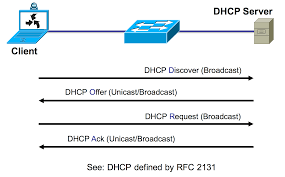

# DHCP - Dynamic Host Configuration Protocol

## IP Address assignment
- MAC Address (6 bytes) : data link layer (L3)
    - first 3 bytes: Organizational Unique Identifier
    - last 3 bytes: Vendor Assigned (NIC Cards, Interfaces)
- IP Network (4 bytes): network layer (L2)

## Dynamic addressing - DHCP

DHCP is a network protocol that **automatically assigns IP addresses and other network settings** to devices when they join a network.

Without DHCP, every device would need **manual IP configuration**, which is error-prone and inefficient.

<!-- defined range of IP addresses (scope) on A DHCP server -->

### What DHCP provides

When a device connects to a network, DHCP can assign:

Setting	 | Purpose
------- | --------
IP address |	Unique network identifier for the device
Subnet mask |	Defines the local network range
Default gateway |	IP of router to reach other networks
DNS server |	IP addresses of DNS servers for name resolution
Lease time	| Duration the IP assignment is valid
Optional: NTP server, domain name, WINS	 | Additional network configs

### How it works

1. DHCP Discover (Client → Broadcast)
    - Device asks: “Is there a DHCP server on the network?”
2. DHCP Offer (Server → Broadcast/Unicast)
    - Server replies with: “Here is an available IP and settings.”
3. DHCP Request (Client → Server)
    - Client requests the offered IP: “I want this IP lease, please.”
4. DHCP Acknowledge (ACK) (Server → Client)
    - Server confirms lease: “You can use this IP for X seconds/minutes.”

> This is commonly called **DORA** (Discover → Offer → Request → Acknowledge).

**Example Scenario**:

Laptop connects to Wi-Fi.

1. Laptop broadcasts DHCP Discover.
2. Router/AP acting as DHCP server replies: `“You can use 192.168.1.20, subnet 255.255.255.0, gateway 192.168.1.1, DNS 8.8.8.8, lease 24h.”`
3. Laptop sends DHCP Request for 192.168.1.20.
4. Router replies ACK → laptop can now communicate on the network.

### Types of IP Assignment

Method |	Description
------- | ------
Dynamic |	IP assigned temporarily by DHCP server (typical for most clients).
Automatic |	IP assigned permanently by DHCP server from pool (like static lease).
Manual / Static	| Admin manually binds IP to a device’s MAC, but DHCP still manages it.

## DHCP Layers

Layer (OSI) | 	How DHCP Uses It
------------ | -----------
Application (L7) | 	DHCP itself is an application protocol — defines the DORA process and data structures (options, IP assignment).
Transport (L4) |	Uses UDP:  - Client → Server: port 68 - Server → Client: port 67
Network (L3) | DHCP messages are encapsulated in IP packets.   - Initial client broadcast has source IP 0.0.0.0 (client doesn’t have IP yet)
Data Link (L2)	| DHCP messages are delivered over Ethernet/Wi-Fi frames.  Broadcast MAC ff:ff:ff:ff:ff:ff for Discover / Offer messages

**Key Notes**
- **Primary layer: Application (L7)** — DHCP is a protocol that runs over UDP/IP.
- **Needs L2/L3 support** because a client doesn’t have an IP initially — broadcast is used to reach DHCP server.
- **DHCP relies on ARP later** to map assigned IPs to MAC addresses for normal communication.