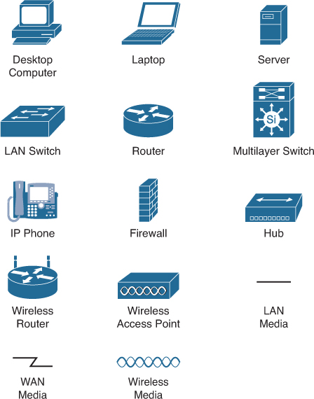
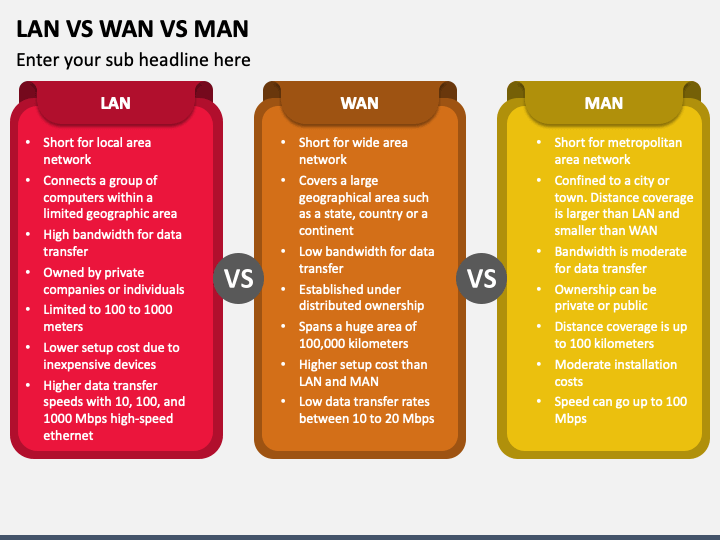
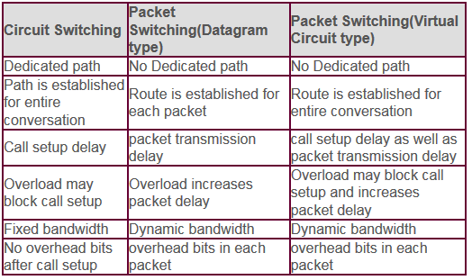
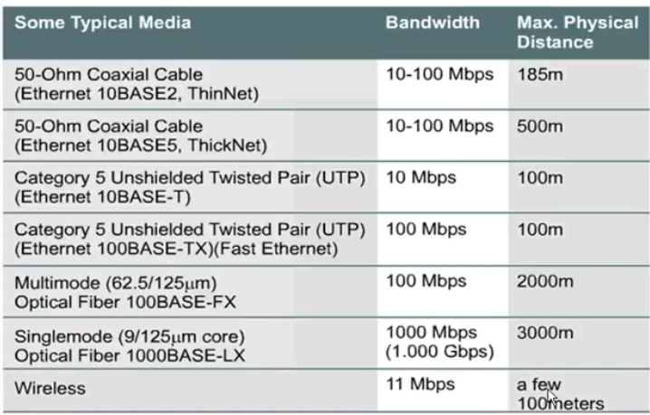
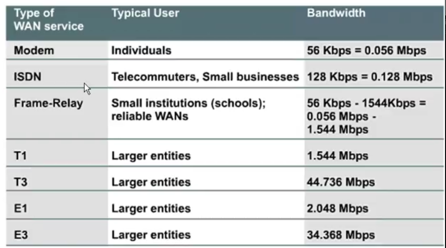

# Network 

## Components in Network

- End devices (hosts): phone, tv, printer, ...
- Media: line, cables, ...
- Protocol

## Data Network 

### Categories by Geo

- LAN: Local Area Network
- WAN: Wide Area Network
- MAN: Metropolitan Area Network 
- GAN: Global Area Network (continents connection)
- SAN: Storage Area Network (peformance + Availability + Scalability)
- VPN: Virtual Private Network

Param | LAN | WAN
------| ----| -----
Speed | high, upto 1-10 Gbps | much lower, generally 100 mbps
Congestion | Less congested | More congested
Components | using the layer 1/2 devices like hubs, swiches, brigdes & layer 3 devices like Core/Layer 3 switch | using the layers 3 devices Routers & Multi-layer Switches 
Ownership & management | owned, operated, managed & monitored by a customer | by multiple Service providers 
Security  | More secured  | Less secured
Technologies | Ethernet & Token Rings | MPLS, ATM, Frame replay & ISDN, ...
Cost         | Less expensive  | More expensive
Physical layer connectivity | Generally Copper & Fiber medium. Multimode Fider is preferred. | Fiber medium. Single mode Fiber is preferred

### WAN vs LAN vs PAN vs MAN

### Categories by switching

### VPN (Virtual Private Network)

**Connect objects**
- Headquarter
- Branch
- Home user
- Mobile user (laptop, mobile)

https://www.slideshare.net/OECLIBOdishaElectron/virtual-private-networks-vpn-ppt

**Types** :
- Network to network (Site to Site)
    - Intranet: network same company
    - Extranet: network between multi companies
- User to Network (Remote-Access VPN) (POP)

## Media

**LAN Media**
- đồng trục
- xoắn đôi
- cáp quang
- vô tuyến

**WAN Media**
- modem (dial-up)
- public data network service (VPN, Frame-relay)
- đường thuê bao dùng riêng (Leasedline based on bandwidth)

## Models

Communication Process

Source Address  ----- Protocol on Media ----- Destination Address

- **Addresses**: who are the source & destination of a communication process 
- **Media**: where is the communication take place
- **Protocols**: set of rules how to make communication on a network

## Protocols

### Common protocols

### Common servers

## Vokas 
- Round-trip time (RTT)
- Network Interface Card (NIC)
- 1 B (Byte) = 8 bit (b)  
- 1024 B = 1 KB
- Bandwith (bps - bit per second)
- Through put <= Bandwidth ( P (throughput) = S (size of file) / T (time to download) )
- LLC - Logical Link Control
- MAC - Media Access Control

## Tools
- [Decimal to Binary converter](https://www.rapidtables.com/convert/number/decimal-to-binary.html)
- [Visual Subnet Calculator](https://www.davidc.net/sites/default/subnets/subnets.html)
- [CIDR](https://cidr.xyz/)

## Refs 
https://viblo.asia/p/so-sanh-chi-tiet-tcp-va-udp-tai-sao-udp-lai-nhanh-hon-tcp-zOQJw05xLMP
