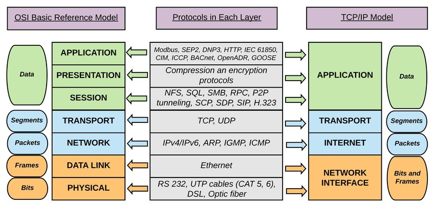
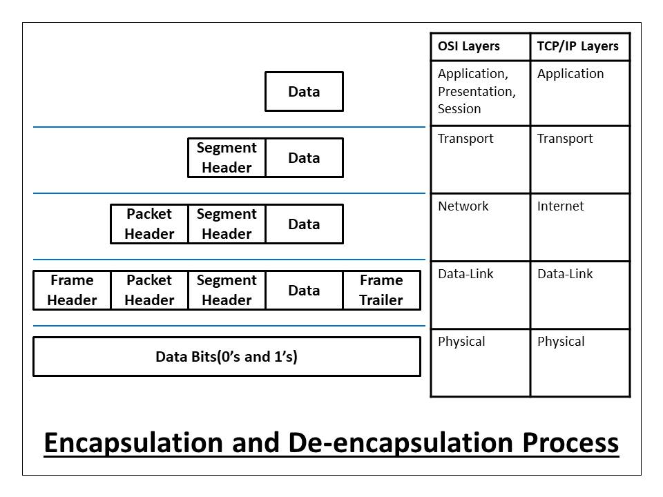

# OSI - Open Systems Interconnection

OSI standardizes how networks should communicate, so different vendors and systems can interoperate.

## OSI vs TCP/IP

1. Physical: Binary transmission 
    - wires, connectos, voltages, data rates
2. Data Link: Access to media 
    - provides reliable transfer of data across media
    - physical addressing, logical network topology, error notification, flow control
3. Network: address & best path
    - provides connectivity & path selection between 2 end systems
    - domain of routing
4. Transport: e2e connections
    - concerned with transportation issues between hosts
    - data transport reliability
    - establish, maintain, terminate virtual circuits
    - fault detection & recovery infor flow control
5. Session: Dialog control - interhost communication
    - establish, maintain, terminate sessions between applications
    - half duplex / full duplex
6. Presentation: Data representation
    - ensure data is readable by receiving system
    - format of data
    - data structure
    - negotiates data transfer syntax for app layer
7. Application: network processes to apps

### Encapsulation Process

https://afteracademy.com/blog/what-is-data-encapsulation-and-de-encapsulation-in-networking/

## Why it’s not implemented literally

In real networks, protocols don’t strictly follow 7 layers.

For example:
- TCP/IP stack (used in the Internet) combines some OSI layers:
    - Network Layer → IP
    - Transport Layer → TCP/UDP
    - Application Layer → HTTP, FTP, etc.
- Presentation and Session layers are often handled inside applications rather than as separate protocols.
- Hardware (switches, routers, NICs) rarely implements OSI layers in a strict 1-to-1 way—they just handle whatever layers they need.

### Layer 1 vs Layer 2

Layer 1 | Layer 2 
--------|---------
cannot organize streams of bit | uses framming to organize or group the bits
cannot identify computer | uses an addressing process to identify computer
cannot communicate with the upper-level layers | uses `LLC` to communicate with the upper-level laye
cannot decide which computer will transmit binary data | uses `MAC` to decide which computer will transmit

